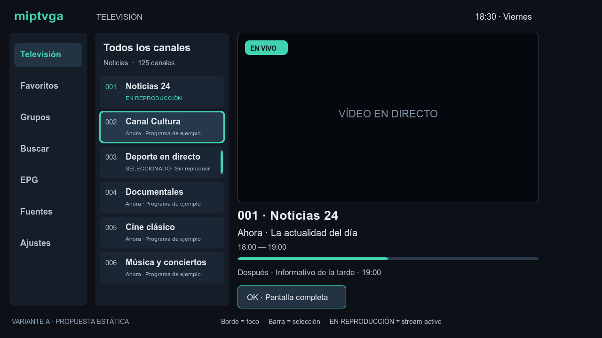
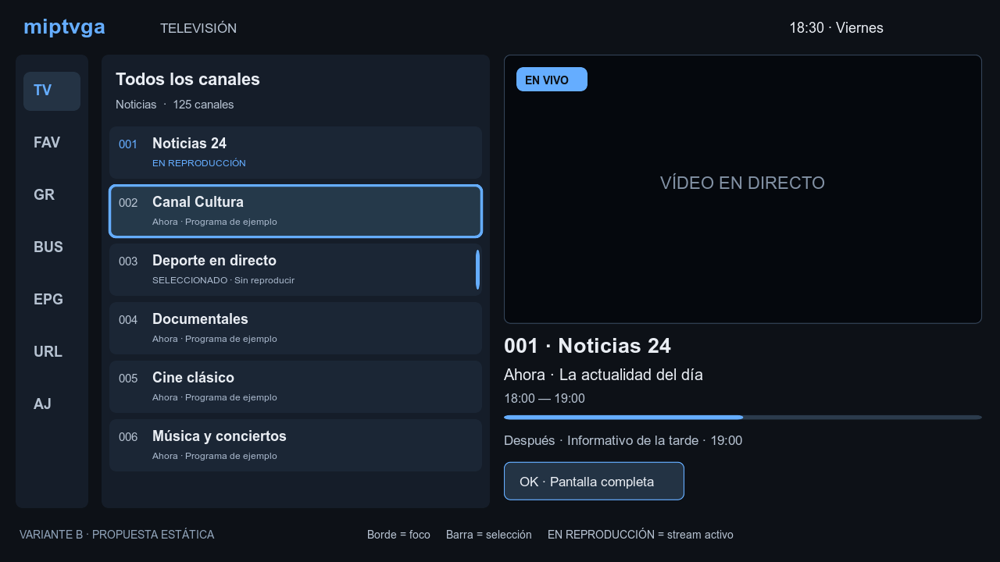

# Auditoría de miptvga: preparación de la versión 2.0

> Este informe describe la línea base 1.1 anterior a los cambios. Los resultados de la implementación autorizada de fase 1 están en [RESULTADOS_FASE1.md](docs/fase1/RESULTADOS_FASE1.md).

Fecha: 13 de noviembre de 2026 (Europe/Madrid). Base: commit `8a2e87f`, versión 1.1, versionCode 2. Primera fase: análisis, comprobaciones y documentación. **No se ha modificado código funcional, configuración Gradle, preferencias, credenciales ni firma. No se han realizado commits ni publicaciones.** Los APK debug generados son salidas locales de las comprobaciones solicitadas.

## 1. Resumen ejecutivo

La aplicación conserva una base aprovechable: lectores M3U por streaming, preparación inicial fuera del hilo principal, índices por grupo, listas Compose virtualizadas, persistencia de favoritos, cachés acotadas y reutilización de reproductores durante el zapping. No está justificado reescribirla ni sustituir LibVLC/ExoPlayer.

La línea base **compila y ensambla debug**, pero no supera los controles de calidad: **27/30 tests pasan; 3 fallan; Lint detecta 147 errores y 56 avisos**. Hay problemas confirmados de parser, navegación numérica, reproducción automática inicial y ciclo de vida de las pantallas auxiliares. Hay riesgos sólidos de respuestas obsoletas, listeners con estado capturado de otro canal y operaciones O(N) en el hilo principal. Ninguna fuga nativa, ANR o regresión de superficie se considera demostrada sin pruebas en Android.

La prueba sintética de un millón de entradas termina en JVM de escritorio, con aproximadamente **264 MiB retenidos por canales y 449 MiB tras entradas e índices por grupo**. No incluye toda la memoria de la aplicación, mapa inverso global, vídeo, EPG ni logos. No acredita que un millón de canales sea viable en una caja Android modesta.

Prioridad propuesta: corregir concurrencia y propiedad del reproductor; aclarar los tests fallidos y corregir Lint; medir en Android; después implementar el explorador aprobado. Se recomienda la variante A del apartado 8, conservando el reproductor integrado a la derecha.

## 2. Alcance, método y evidencias

Se inventariaron las 28 fuentes Kotlin principales (12.727 líneas), cuatro archivos locales de tests, manifiesto, recursos XML, Gradle, wrapper, ProGuard, CI, reglas Git y documentación. Se revisaron las rutas de entrada, carga, preparación, filtrado, reproducción, navegación, EPG, cachés y persistencia, incluidas las implementaciones duplicadas en `ui/`. No se abrieron keystores ni se reprodujeron listas privadas. Los directorios de herramientas/cachés y binarios preexistentes no se consideran código fuente auditado.

Evidencias reproducibles en [docs/auditoria](docs/auditoria/):

- [Inventario y SHA-256](docs/auditoria/inventario.json): fuentes y configuración revisadas, incluidos tests ignorados.
- [Resumen de comprobaciones](docs/auditoria/comprobaciones.txt) y [Lint completo con rutas relativas](docs/auditoria/lint-debug.xml).
- [Microbenchmark reproducible](docs/auditoria/medir_listas.py), [mediciones](docs/auditoria/mediciones_jvm.txt) y [casos de parser/XMLTV](docs/auditoria/casos_parser_jvm.txt).
- [Variante A](docs/auditoria/propuesta_a.svg) y [variante B](docs/auditoria/propuesta_b.svg): maquetas estáticas de propuesta, no capturas ni interfaz implementada.

Clasificación de evidencia:

- **Confirmado por ejecución**: resultado observado en las comprobaciones indicadas; se precisa si fue JVM o Android.
- **Confirmado por código**: flujo y resultado deterministas localizables; sin atribuir mediciones o síntomas no observados.
- **Riesgo fundamentado**: condición de carrera, recurso o comportamiento cuyo efecto depende de secuencia/dispositivo. Requiere reproducción.
- **Pendiente**: no hay evidencia suficiente para un diagnóstico.

### Comprobaciones realizadas

| Comprobación | Resultado real |
|---|---|
| `./gradlew --offline --no-daemon :app:assembleDebug :app:testDebugUnitTest :app:lintDebug :app:check` | Primer intento bloqueado por escritura de lock en caché; reejecutado con permisos, falló al faltar `foojay-resolver:1.0.0` offline. No fue error de fuentes. |
| Misma selección de tareas sin `--offline` | Dependencias públicas resueltas, Kotlin compilado; tests detuvieron la ejecución conjunta: 3 fallos de 30. |
| `./gradlew --no-daemon --offline :app:assembleDebug :app:lintDebug :app:check --continue` | Ensamblado debug correcto, incluido renombrado local; tests vuelven a fallar. Lint inicialmente bloqueado por `ui-tooling-jvmstubs:1.7.6` sin caché. `check` no supera dependencias. |
| `./gradlew --no-daemon :app:lintDebug :app:dependencies --configuration debugRuntimeClasspath` | Árbol de dependencias obtenido; Lint ejecutado y fallido: 147 errores, 56 avisos. |
| `python3 docs/auditoria/medir_listas.py` | Parseo y estructuras sintéticas de 1k, 10k, 100k, 500k y 1M; sin red. |
| `python3 docs/auditoria/medir_listas.py --cases` | Casos vacíos/básicos correctos; pérdida de nombre con coma y ausencia de atributos sin comillas; XMLTV con offsets sin programas en JVM. |
| `adb devices -l` | Primer intento impedido por sandbox; reejecución correcta: **ningún dispositivo conectado**. |

No se ejecutaron release, publicación, instalación, `clean`, actualización de dependencias ni creación de baseline de Lint. Se usaron cachés Gradle existentes; no es una compilación desde un entorno vacío. Los informes originales están en `app/build/reports/tests/testDebugUnitTest/` y `app/build/reports/lint-results-debug.html`.

## 3. Errores y riesgos por prioridad

### Críticos

**No hay un fallo crítico reproducido en dispositivo.** Esto no garantiza ausencia de fallos críticos. No deben confundirse los errores de Lint con 147 fallos de ejecución.

### Altos

**A1. Respuestas antiguas pueden reemplazar listas recientes o repoblar un restablecimiento. Riesgo fundamentado.**

- Archivos/funciones: `MainViewModel.kt:825`, `loadFromUrlInternal`, `loadFromUriInternal`, `loadFromFileInternal`, `applyLoadedChannels`, `resetPreferences`; también cargas del explorador.
- Cada solicitud lanza una corrutina independiente sin conservar un `playlistLoadJob` ni comprobar una generación. La preparación suspende en Default y después aplica snapshots de favoritos/grupo/búsqueda que pueden haber cambiado. `resetPreferences` tampoco cancela estas cargas ni `filterJob`.
- Secuencia a reproducir: A tarda, B finaliza primero y luego A sobrescribe B; restablecer mientras se carga; cambiar favoritos durante preparación.
- Propuesta: un job por operación, cancelación cooperativa y token de generación antes de publicar; capturar estado inmutable de entrada y reconciliar el estado editable vigente. Mantener datos antiguos hasta completar la sustitución de forma atómica.
- Riesgo de corrección medio: hay que conservar la lista que sigue reproduciendo y evitar que un error deje una fuente diferente a los datos visibles.

**A2. El job de descarga EPG no se cancela al refrescar/desactivar. Confirmado por código; carrera pendiente de reproducción.**

- `MainViewModel.kt:530`, `refreshEpg`: cancela `epgRefreshJob`, pero no asigna a esa variable el `viewModelScope.launch` de descarga. La variable solo termina conteniendo el ticker.
- Otra descarga puede completar después de desactivar EPG, cambiar URL/lista o restablecer; puede publicar datos anteriores y reiniciar el ticker.
- Propuesta: separar `epgLoadJob` y `epgTickerJob`, validar generación, URL e identidad de lista; propagar `CancellationException`. Prueba con respuestas locales demoradas en orden inverso.

**A3. Listeners de ambos reproductores conservan capturas de la primera composición. Riesgo fundamentado alto.**

- `PlayerSurface.kt:246` y `:624`, `DisposableEffect(mediaPlayer/exoPlayer)`.
- El reproductor se conserva al cambiar URL; su listener también. El listener usa directamente `playbackUrlInfo` inicial en `EndReached` y holders de reconexión que se recrean mediante `remember(streamUrl, requestHeaders)`. Las referencias con `rememberUpdatedState` no corrigen esas capturas directas.
- Consecuencia posible: VOD posterior tratado como directo o viceversa, contador/token antiguo que ya no observa el efecto activo, finalización atribuida al canal reciente. `onPlaybackEnded` del ViewModel marca el índice actual sin verificar una identidad de sesión.
- Propuesta: estado de sesión estable, metadatos actualizados explícitamente y callbacks asociados a una generación. Verificar con backend simulado la secuencia live → VOD → live, fin/error tardío y cinco cambios rápidos; luego ambos motores reales.

**A4. Abrir Buscar/Guía/Ajustes destruye la composición propietaria del reproductor. Confirmado por código.**

- `AppScreens.kt:527`, `RootScreen`: el `when(currentScreen)` retira `MainScreen`; los `onDispose` de `PlayerSurface.kt` detienen y liberan el motor.
- Al volver se crea otra sesión para el índice que seguía seleccionado. Impide mantener reproducción mientras se usan esas pantallas. No confundirlo con cambiar de grupo dentro de MainScreen, que sí conserva la selección.
- Propuesta: propietario estable fuera de la rama de pantallas; auxiliares como paneles/superposiciones y superficie enlazada explícitamente. Verificar que el contador de creaciones y peticiones del stream no cambia al abrir/cerrar guía.

**A5. Reconexiones de fin de stream sin límite y clasificación HTTP insuficiente. Confirmado por código; impacto operativo pendiente.**

- `PlayerSurface.kt`, listeners `EndReached`/`STATE_ENDED`: incrementan intentos y aplican backoff, pero esa rama no comprueba el máximo. `Playing`/`STATE_READY` reinicia contadores. `endReconnectAttempt` se reinicia pero no limita los fines.
- La rama de error sí limita por tipo de stream/decoder; no existe una política explícita para autenticación denegada o recurso inexistente. Keep-alive puede continuar cada 8 s tras sus reintentos internos; el fallback entre motores no impone presupuesto global.
- Propuesta: presupuesto por episodio y ventana temporal, distinguir HTTP temporal/permanente y no reiniciar hasta un intervalo de reproducción estable; mantener reintento manual. Probar 401/403/404/429/503, cortes y stream que termina repetidamente con servidor de pruebas local.

**A6. Calidad automatizada bloqueada y tests fuera del control de versiones. Confirmado por ejecución/código.**

- `.gitignore` excluye `**/src/test/**` y `**/src/androidTest/**`. Existen cuatro tests locales, ninguno aparece en `git ls-files` para esas rutas.
- `.github/workflows/ci.yml`: tests con `continue-on-error: true`; no ejecuta Lint. Una copia limpia no conserva estos tests locales.
- Resultado local: parser 10/10, favoritos 3/3, grupos 2/2, heurísticas 12/15. Fallan `reconnectsAmbiguousRemoteXtreamStyleStreamAfterEnd`, `disablesPlaybackCacheForAmbiguousRemoteXtreamLikeStream` y `recoversRemoteXtreamLikeStream`: esperan `isLikelyLiveStream == false`, mientras `get.php` se clasifica como live. Es una **discordancia confirmada entre contrato de tests y código**, no demostración de stream fallido. No cambiar expectativas automáticamente.
- Lint: 144 `UnsafeOptInUsageError` por Media3, 3 `RestrictedApi` en `MainActivity` (dispatch de eventos). Resolver propagación excesiva de anotaciones, usos y contratos de APIs antes de silenciar. Reproducir interacción tras cualquier cambio de dispatch.
- Propuesta: conservar/versionar tests tras aprobación; hacerlos obligatorios y añadir Lint a CI, sin baseline que esconda errores.

**A7. Trabajo O(N) síncrono en cambios de grupo y favoritos. Confirmado por código y microbenchmark parcial.**

- `MainViewModel.kt:1007`, `scheduleFiltering(preferSync=true)` llama `computeFilterResult`, que construye un `HashMap<Int,Int>` de todos los resultados. El índice de grupos evita el recorrido inicial, pero cambiar a Todos sigue siendo O(N), no O(1).
- `toggleFavoriteById`/`toggleFavoriteGroupById` llaman `buildChannelGroups` en Main; recorren toda la lista y vuelven a contar favoritos. `SidePanel` hace `firstOrNull` lineal por recomposición.
- Propuesta y verificación en apartado 4. No se ha observado ANR real.

### Medios

**M1. Inicio reproduce automáticamente y no restaura un canal independiente. Confirmado por código.** `prepareLoadedChannels` llama `computeFilterResult(preservePlaybackSelection=false)`, elige la primera entrada; `PlayerPanel` compone `PlayerSurface` y los motores llaman `play`. `LastPlaylistStore` guarda grupo pero no último canal ni ajuste autoplay. Proponer foco/selección restaurados y `playingChannelId` inicialmente vacío; autoplay opcional desactivado. Migración sin cambiar las claves existentes.

**M2. Números ligados al filtro, sin indicación y con selección por ajuste de rango. Confirmado por código.** `MainActivity.kt:195–215`, `appendNumberInput`/`jumpToChannelNumber`: espera fija 1.200 ms, `number-1` sobre `filteredChannels`, `coerceIn` hace que 0 o un número mayor seleccione primero/último. Intercepta dígitos globalmente incluso al escribir en formularios; no hay ajuste para desactivar ni overlay. Proponer índice numérico de fuente estable y rechazo discreto de número inexistente, sin interceptar edición de texto. No cambiar IDs de favoritos.

**M3. Nombre con comas truncado. Confirmado en JVM con parser original.** `M3uParser.kt:49` usa `substringAfterLast(',')`: `Noticias, España` se convierte en `España`. Localizar el separador EXTINF fuera de atributos entrecomillados y conservar el resto. Grupos sin comillas devuelven null; esto es limitación de compatibilidad, no un fallo de toda lista. Añadir casos de comas dentro de atributos, BOM, Unicode, vacíos y EXTINF incompletos.

**M4. Fechas XMLTV con offset: incompatibilidad reproducida en JVM, validación Android pendiente.** `XmltvParser.kt:132`, `toZoneOffsetFormat`: transforma `+0100` en `+01:00` pero usa patrón `Z`. Con el parser original compilado y kxml2, tanto `+0100` como `+01:00` producen cero timelines; sin offset produce dos claves (id y nombre) del mismo programa. Un ensayo separado con OpenJDK 21 confirma `ParseException` con `+01:00`, aceptando `+0100`. No extrapolar sin probar libcore de Android 24/35. Proponer patrón y entrada coherentes, política XMLTV sin zona explícita y pruebas DST/offsets; no depender de la zona del dispositivo silenciosamente. Referencia: [SimpleDateFormat Android](https://developer.android.com/reference/java/text/SimpleDateFormat.html).

**M5. Cancelación no cooperativa en parsers y HTTP bloqueante. Confirmado por código.** `M3uParser.parse`, `XmltvParser.parseProgramTimelines` no consultan cancelación; `PlaylistLoader.withUrlReader` usa `execute` sin enlace a `Call.cancel`, y keep-alive captura `Throwable` y usa `Thread.sleep`. `runCatching` alrededor de suspensiones también captura cancelación. Aunque IO evita bloquear Main durante lectura, el trabajo antiguo puede seguir consumiendo CPU/red. Proponer `ensureActive` por lotes, propagación de cancelación y puente de OkHttp cancelable. Los lectores/respuestas sí usan `use`; no afirmar fuga de esos streams.

**M6. Búsqueda puede restaurar una selección antigua. Riesgo fundamentado.** `scheduleFiltering` valida query, grupo, favoritos e identidad de lista antes de publicar, pero no el `selectedIndex` capturado. Si se reproduce otro canal mientras filtra, `applyFilterResult` puede volver al índice anterior. Proponer resolver visibilidad con el índice vigente al publicar. Prueba con filtro deliberadamente demorado.

**M7. Mismas URL con nuevas cabeceras conservan cabeceras anteriores. Confirmado por código.** Ambos backends usan `stableRequestHeaders = remember(streamUrl)`, aunque `requestHeaders` pueda cambiar sin cambiar URL. Incluir cabeceras en identidad de sesión o actualizar el snapshot aplicado. Verificar dos entradas con misma URL y distinto Referer/Authorization sintéticos, sin registrar sus valores.

**M8. Limpieza de caché con reproductor activo y en Main. Riesgo fundamentado.** `PlaybackCache.releaseAndClear`, `MainActivity.onDestroy/closeForBackgroundExit` y mantenimiento del ViewModel pueden liberar el singleton sin coordinar lectores activos. `onDestroy` recorre/borra caché en Main, también en recreación de Activity. Proponer detener/desvincular lectores con propietario estable y limpiar en IO; verificar con reproducción que utilice realmente caché y rotación. `SimpleCache` sincroniza creación, pero eso no sincroniza sus consumidores.

**M9. EPG envejece sin nueva descarga y calcula en Main. Confirmado por código.** `startEpgTicker` solo selecciona actual/siguiente cada minuto; no renueva la ventana de 36 h descargada. `EpgRepository` construye intereses antes de entrar en IO y el ticker recorre timelines dos veces en Main. La EPG automática se pospone por encima de 40.000 canales; el refresco manual puede saltarse esa barrera. Proponer renovación separada con caché/condicionales HTTP, binary search/cursor y procesamiento Default, con límites explícitos.

**M10. Progreso EPG congelado dentro del mismo programa. Confirmado por código.** `AppScreens.kt:1131` y copia `ui/GuideScreen.kt:351`: `remember(currentProgram)` calcula con reloj solo al cambiar el programa. El ticker puede emitir programas iguales y no invalidar ese remember. Proponer reloj compartido, actualizado solo mientras la guía/OSD sea visible.

**M11. Exposición de URLs y respaldo de credenciales. Riesgo fundamentado sobre flujos confirmados.** `LastPlaylistStore` persiste fuente/EPG en SharedPreferences sin cifrar; los IDs de favoritos contienen `streamUrl`. Manifiesto permite backup sin reglas específicas. `ChannelInfoScreen` muestra stream completo y ajustes/OSD pueden mostrar la etiqueta de fuente, que para URL es la URL íntegra. No se hallaron logs de aplicación explícitos con esas URLs, pero mensajes de excepción se muestran sin redacción. Proponer ocultar usuario, contraseña, path Xtream, query y cabeceras sensibles en presentación/errores; política de backup y almacenamiento protegido con Android Keystore si se valida su necesidad. Mantener compatibilidad leyendo claves antiguas y migrando de forma reversible. No se han inspeccionado valores privados.

### Bajos y mantenimiento

- **B1. Duplicación de UI:** `AppScreens.kt` contiene pantallas privadas y componentes duplicados de `ui/` y `ui/components/`. RootScreen llama a las privadas del mismo archivo; editar solamente `ui/` puede no cambiar la aplicación. Confirmado por resolución de llamadas/imports. Extraer por pasos y redirigir la raíz solo después de pruebas de paridad.
- **B2. APIs/modelo de estado demasiado amplios:** `MainViewModel` combina fuentes, EPG, navegación, cachés, favoritos y reproducción; sus subestados se crean como getters sobre un único UiState. No obliga a sustituir MVVM; separar flujos cuando reduzca invalidaciones medidas.
- **B3. Historial de vistos:** `saveWatchedIds` retiene los primeros 4.000 de un Set y la memoria del ViewModel no se recorta. Las nuevas entradas pueden no persistir una vez lleno. Proponer política de recientes explícita y límite también en memoria; no afirmar pérdida de favoritos.
- **B4. Red:** `NetworkMonitor.onAvailable` indica true antes de validación; múltiples redes pueden producir estados contradictorios. El registro captura errores silenciosamente. `isNetworkAvailable` no se consume por el reproductor; recuperar red solo reinicia keep-alive Xtream. Probar red validada real/default network y reanudación de ambos backends.
- **B5. Lint restante:** avisos de APIs inline, accesibilidad táctil, iconos duplicados/formas, overdraw, locale, ABI y versiones. No asumir crash de APIs inline por usar constantes ni actualizar bibliotecas por el mero aviso.

## 4. Cuellos de botella: evidencia, solución y verificación

N = canales; K = resultados visibles del grupo/filtro; G = grupos; P = programas retenidos.

| Archivo/función | Causa e impacto | Evidencia disponible | Propuesta | Riesgo de regresión | Verificación |
|---|---|---|---|---|---|
| `M3uParser.parse` + `Models.ChannelListEntry` | Lectura incremental, pero retención O(N); cadenas de favorito incluyen nombre/grupo/URL y se crean IDs de grupo por entrada | 264 MiB canales y 449 MiB indexados en 1M JVM | Conservar parser, compartir metadatos repetidos, revisar representación/identidad y límite antes de almacenamiento paginado | Medio: compatibilidad IDs, orden, favoritos | Heap/PSS/GC en ART con los cinco tamaños y mismas fixtures |
| `computeFilterResult` | `HashMap<Int,Int>` reconstruido O(K), boxing y asignaciones; Main en cambio síncrono | 57,7 ms para mapa global de 1M en JVM, excluye UI | Evitar mapa completo para resolver un único índice; reutilizar índice por grupo o usar arrays primitivos cuando se justifique; Default para trabajo grande | Medio: índice seleccionado/scroll | Traza Main y p50/p95 al alternar Todos/grupos |
| `buildChannelGroups` desde favoritos | Cuenta toda la lista y reordena G en Main por clic | Recorridos confirmados, sin perfil Android | Cachear conteos e incrementar por grupo/canal; snapshot y cálculo Default antes de publicar | Medio: favoritos de grupo y virtual | Igualdad funcional y coste al marcar/desmarcar en 1M |
| Búsqueda `groupFiltered.filter` | O(K) por consulta; debounce 220 ms pero filtro no cooperativo | Consulta `999`: 64,8 ms con 1M en JVM | Cancelar por bloques; evitar mapa inverso completo; normalización cacheada solo si justifica memoria; caché pequeña con versión de fuente | Medio: Unicode, memoria adicional | Consultas rápidas y vacías, latencia p95 y CPU cancelada |
| `SidePanel` | `firstOrNull` lineal para índice seleccionado en recomposición | Código; no coste aislado medido | Resolver entrada con acceso directo por índice/ID | Bajo | Perfetto/recomposition counters en reproducción/EPG |
| `EpgRepository`, `resolveCurrent/NextPrograms` | Intereses y búsquedas O(N/P), dos recorridos por tick, formateadores por fecha | Código, sin perfil EPG grande | Sets construidos una vez; cursor/binaria sobre timelines, reutilizar formatters por parser; filtrar interés/ventana antes de trabajo costoso | Medio: cambios horarios/programas solapados | XMLTV sintético, heap y duración por tick |
| `PlayerSurface` | Estado consultado cada 500 ms aun con OSD oculto | Dos bucles `LaunchedEffect`, cada backend activo | Eventos para estado y sondeo de posición solo con consumidor visible | Bajo/medio: controles actualizados | Contar emisiones/CPU con OSD visible/oculto |
| `PlaybackCache.getCache` y `onDestroy` | Inicialización DB/cache y borrado de disco desde rutas Main | Rutas de llamada, sin ANR observado | Preparación y mantenimiento coordinados en IO | Medio: API/lectores activos | StrictMode y trazas de apertura/salida |
| `ChannelLogo`, `ImageLoaderConfig` | AsyncImage virtualizado y caché compartida; reserva hasta 25% heap y 100 MiB disco | Configuración; no descarga masiva explícita | Medir reducir cuota en low-RAM; tamaño de petición acorde a caja visible si Coil no lo resuelve como se espera | Medio: nitidez y churn | Logos grandes/repetidos/404; requests, heap y cache hit rate |
| `basicMarquee` en `SidePanel` | Animación indefinida de títulos largos | `iterations = Int.MAX_VALUE`; coste GPU pendiente | Solo en foco o texto estático truncado | Bajo | Frame timing/CPU sin interacción |

No hay comparación antes/después: no se ha aplicado ninguna optimización. Las mejoras propuestas aún no tienen ganancia acreditada.

## 5. Arquitectura y reproducción

### Qué conservar

- `PlaylistLoader` cierra response/body/reader y lee con BufferedReader; no carga la lista remota completa como String. `parse(String)` queda útil para tests.
- Preparación inicial de entradas e índices en Default; filtros con debounce y comprobación parcial de snapshots.
- LazyColumn/LazyRow con claves por índice original/grupo y `contentType`; no se crean millones de composables simultáneamente. Las claves por índice son estables durante la vida de la lista, no entre reordenaciones de fuente.
- Un MediaPlayer/ExoPlayer por composición, reaprovechado para zapping; listeners se retiran y motores se liberan en dispose.
- Fullscreen actual conserva `PlayerPanel` en el mismo punto del árbol y cambia modificadores; **no se ha detectado recreación incondicional por el booleano fullscreen**. Hay guardia de transición y posible reconexión si la reproducción no está activa; requiere pruebas reales, especialmente si estaba pausada.
- Seek condicionado a capacidades del motor; no equivale a disponer de un grabador timeshift propio.
- `SharedPreferences.edit` utiliza apply por defecto: no se considera una escritura síncrona de disco en cada clic. Sí hay copias y serialización cuya escala debe medirse.

### Evolución mínima propuesta

```text
Activity / RootScreen estable
 ├─ MainViewModel: fuente, grupos, selección, favoritos, navegación
 ├─ propietario de reproducción estable: sesión + backend + estado
 │   ├─ LibVLC o ExoPlayer (solo uno activo)
 │   └─ PlayerSurface: enlazar/desenlazar vídeo; no decidir cargas
 └─ paneles Compose: explorador, guía, ajustes, fullscreen y OSD
```

No hace falta imponer nuevos módulos ni framework de inyección. Extraer el controlador existente gradualmente; dar a cada sesión una generación y tres estados separados: foco, selección y canal reproducido. Guardar grupo y canal seleccionados sin poner credenciales en un ID nuevo. Mantener IDs persistidos de favoritos y migraciones explícitas si se cambia representación.

El propietario puede ser un ViewModel dedicado o controlador retenido mientras vive la raíz, con contexto de aplicación y liberación explícita. No retener Activity, PlayerView, SurfaceView o TextureView en un ViewModel. Una superficie pertenece al ciclo de vida de su vista; no se debe tener la misma superficie nativa enlazada a dos contenedores. Conservar inicialmente la estrategia actual de una sola superficie que cambia tamaño para fullscreen y comprobar continuidad antes de diseñar traslados.

Los buffers actuales son altos: VLC usa 15 s de caché de red y opciones específicas Xtream/VOD; ExoPlayer crea `createExoLoadControl` con 25–70 s y umbrales 2,5/6 s. `createExoLoadControlForStream` existe pero no tiene llamadas: sus perfiles no son efectivos. No reducir parámetros sin medir primer frame, cortes y RAM; tampoco asumir que milisegundos de buffer equivalen a memoria reservada constante. La espera de teardown añade 350/500 ms deliberadamente para paneles de una conexión.

Las acciones multimedia se procesan sobre la superficie enfocada: play/pause/seek; hay channel up/down en Activity. No se encontró MediaSession ni manejo completo de STOP/NEXT/PREVIOUS multimedia. Proponer enrutador único y MediaSession solo si se necesitan eventos globales/sistema; evitar duplicados entre Activity, Compose y PlayerView. No añadir reproducción en segundo plano como efecto lateral de esta refactorización.

## 6. M3U, grandes listas y EPG

El parser es streaming en entrada, **no acotado en salida**. No hay paginación ni almacenamiento persistente del catálogo: el arranque restaura la fuente y vuelve a cargarla. Contiene grupo/logo/tvg-id, EXTVLCOPT y cabeceras inline. No valida toda línea no comentada como URL, no resuelve rutas relativas de playlist respecto a su fuente y no distingue explícitamente un manifiesto HLS de segmentos de un catálogo IPTV. Son casos que requieren definir contrato y preservar compatibilidad; no rechazar protocolos admitidos por los motores de forma indiscriminada. Los archivos usan UTF-8 por defecto; HTTP puede usar charset del body. No se detecta fallback de codificación local.

Antes de Room/SQLite: medir representación más compacta y eliminar mapas/cadenas redundantes. Si el catálogo supera el presupuesto ART de dispositivos objetivo, un almacenamiento persistente indexado y consulta paginada sí se justifica por memoria y arranque. Debe elegirse con datos, no añadirse como dependencia preventiva. No hay garantía técnica de admitir millones en todos los dispositivos usando un catálogo completamente en memoria.

EPG usa XmlPullParser e intereses por id/nombre, conserva ventana pasada 3 h/futura 36 h y ordena al finalizar. No carga XML completo como String. No deduplica programas ni acota número de registros por canal; alias pueden tener listas separadas con referencias compartidas al mismo programa, no necesariamente objetos de programa duplicados. Revisar XML truncado, orden channel/programme, gzip XMLTV, DTD/entidades y límites; no hay prueba que demuestre XXE explotable. La guía actual es de actual/siguiente; una parrilla temporal requeriría exponer timelines a UI y virtualizar canales y franjas visibles, nunca la matriz entera.

## 7. Seguridad, dependencias y compatibilidad

- HTTP cleartext global y redirecciones entre protocolos están permitidos; son opciones existentes necesarias para muchos proveedores. Proponer HTTPS preferente y política visible por fuente, sin cortar HTTP legítimo por defecto.
- `MANAGE_EXTERNAL_STORAGE` sirve al explorador y conlleva acceso amplio; el flujo activo solicita permisos. Existe carga por URI en el ViewModel, pero no se encontró picker SAF conectado al flujo activo ni persistencia de permiso URI. No afirmar que el acceso URI restaurado esté validado. Ofrecer SAF como alternativa sin eliminar explorador.
- Activity launcher exportada intencionadamente; no se declaran servicios/receptores exportados adicionales en el manifiesto fuente. Receiver dinámico de apagado es no exportado donde procede. Revisar siempre manifest fusionado de release antes de distribución.
- **Hallazgo descartado:** `ACCESS_NETWORK_STATE` falta en fuente pero está presente en el manifiesto debug fusionado por Media3 common/ExoPlayer 1.5.1. No se confirma crash por permiso ausente. Sería razonable declararlo explícitamente para no depender de una biblioteca. La exigencia de API está documentada en [ConnectivityManager](https://developer.android.com/reference/android/net/ConnectivityManager).
- SDK mínimo 24 y target/compile 35 se conservan. ABI filtrada a ARMv7/ARM64: la validación nativa requiere ARM o un entorno compatible; un emulador x86 sin traducción no valida VLC.
- AGP 9.1.0, Gradle 9.3.1, Kotlin/Compose plugin 2.2.10; BOM 2025.01.00 resuelve Compose 1.7.6. Media3 1.5.1, VLC 3.6.5, Coil 2.7.0, OkHttp 4.12.0, coroutines 1.9.0. El árbol resolvió y el ensamblado pasó; no se propone una actualización masiva. `kotlin-test` declarado 2.0.21 merece alineación revisada con el compilador.
- Gradle advierte de deprecación de `android.builtInKotlin=false`, `android.newDsl=false` y la extensión Android antigua: planificar migración independiente antes de AGP 10, sin mezclarla con reproducción.
- Se obtuvo el árbol de dependencias; **no se ejecutó un escáner CVE/SCA ni se certifica ausencia de vulnerabilidades** en bibliotecas Java o VLC nativo. Lint de versiones no sustituye SCA. No se añadió telemetría.

## 8. Dos propuestas visuales TV first

Ambas respetan navegación izquierda, explorador central y reproductor derecho. Nada de portada de recomendaciones. Las dimensiones de maquetas son píxeles de presentación, no dp definitivos.

### A. Explorador compacto turquesa — recomendada



Rail de navegación con etiquetas siempre visibles; centro compacto con grupo activo, búsqueda y filas de canal; derecha amplia con vídeo 16:9, actual/siguiente, progreso, estado y botón fullscreen. Menor carga de descubrimiento para mandos sencillos. Sobre una base de 1280×720: rail aproximado 164 px, explorador hasta x=470 y vídeo desde x=505; las medidas finales se adaptarán a dp y distancia de visión.

Paleta: fondo `#0D1117`, panel `#151D29`, filas `#1B2635`, texto `#E9EDF3`, secundario `#B6C2D1`, acento `#41D3B0`, error `#D97171`. Sin blur ni animación continua. Bordes y rellenos sólidos; transición de 100–150 ms prescindible con reducción de movimiento. Tipografía de fila de referencia 18–22 sp en TV, validada en pantalla real.

### B. Rail compacto azul y explorador amplio



Rail de iconos con expansión etiquetada al recibir foco; centro más ancho para nombres largos y EPG; vídeo derecho más pequeño. Acento `#65ADFF`, misma base oscura. Mayor densidad sin tarjetas grandes. Riesgo adicional: expansión del rail puede mover geometría/foco; usar espacio reservado y etiquetas superpuestas para mantener el anclaje. Semántica accesible imprescindible para iconos.

La variante A es preferible inicialmente por claridad y menor complejidad de foco. Las maquetas no usan logos remotos ni contenido privado. En ambas, borde de alto contraste = foco; barra lateral = selección; distintivo «EN REPRODUCCIÓN» = sesión activa. El color no será el único indicador.

### Navegación y foco propuestos

| Entrada | Acción |
|---|---|
| Arriba/abajo | Cambiar foco dentro del panel, sin cambiar stream |
| Izquierda/derecha | Pasar entre rail, explorador y reproductor; recordar ancla por panel |
| OK en canal | Seleccionar y reproducir; no entrar automáticamente en fullscreen |
| OK en reproductor | Fullscreen conservando sesión y superficie |
| Atrás | Cerrar menú/diálogo, panel rápido, fullscreen o auxiliar, en ese orden contextual |
| OK prolongado | Menú contextual de favoritos/vistos/lista continua, también accesible con botón visible |
| Rojo/verde/amarillo/azul | Favoritos/EPG/buscar/grupos; azul actualmente abre ajustes, requiere cambio deliberado y preferencia si viable |
| Números | Overlay, resolver índice estable de fuente tras 1.200 ms configurable; no encontrado sin reproducir otro canal |
| Play/pause/stop/next/previous | Un único enrutador; respetar capacidades. Seek solo si el motor lo permite |
| Ratón/táctil | Clic y toque activan; rueda desplaza; doble clic sobre vídeo para fullscreen si no interfiere con controles; hover sin robar foco |

Foco: una ancla por panel y por diálogo, no un requester para cada canal del catálogo. Recordar ID y scroll por grupo; restaurar al cerrar auxiliares sin solicitar foco por cada actualización EPG/logo. Si desaparece una entrada, vecino válido o cabecera. Actualizar logos con caja fija. Evitar que callbacks creados en recomposición vuelvan a reiniciar efectos de foco. Las listas ya tienen varios mecanismos locales útiles, pero falta una política transversal verificable.

Fullscreen: misma sesión; izquierda abre lista rápida superpuesta, arriba/abajo enfoca, OK reproduce, Atrás cierra. Vídeo visible detrás sin blur. OSD con número, nombre, programa, horario, progreso y estado; autoocultación de 4 s configurable con actividad; ocultar debe detener el sondeo visual innecesario. Ninguna acción dependerá de botones de colores exclusivos.

Móvil: navegación compacta y distribución apilada, vídeo arriba y explorador debajo o vistas alternables; no comprimir tres paneles. Tablet: dos áreas visibles según ancho. La detección actual por tamaño/orientación se puede conservar, añadiendo pruebas específicas de TV y baja altura. Preservar búsqueda, fuente local/URL/URI, EPG, info, ajustes, favoritos de grupos, vistos, reproducción continua y limpieza de caché.

## 9. Mediciones reales y escenarios reproducibles

### Entorno

Linux x86_64, kernel 6.8.0-147-generic; Intel Core i7-10700 @ 2,90 GHz, 8 cores/16 hilos; RAM total 15.858 MiB. OpenJDK 21.0.12.1. SDK locales 34/35/36 y build tools 34–37 disponibles; compilación usa el proyecto sin alterar SDK. Sin dispositivo Android conectado.

El harness compila **copias exactas** de M3uParser y Models con Kotlin embeddable 2.2.10 de caché; solo sustituye la anotación Compose `Immutable` con un stub para permitir JVM aislada. La extensión posterior de casos incluye XmltvParser y kxml2 2.3.0. No modifica las fuentes originales ni usa el stack multimedia Android.

Cada tamaño usa proceso Java independiente con `-Xmx1536m`, calentamiento de 1.000 entradas y una medición. Generador Reader incremental, URL `example.invalid`, nombres únicos y 100 grupos. Tiempo de parseo incluye generación del texto. Preparación incluye entradas, índice por grupo y agregación; consulta `999` incluye lista de resultados y mapa inverso. Cambio de grupo mide lookup y construcción del mapa de ese grupo; no navegación Compose. Mapa «Todos» replica el bucle de `computeFilterResult`, no toda la función privada ni el ViewModel.

Heap = diferencia `totalMemory-freeMemory` después de GC solicitado y pausa de 100 ms; **estimación de retención**, no pico ni RSS/PSS. El GC no está garantizado: valor negativo en 1.000 canales es ruido, no ahorro real. No son medias ni percentiles; carga concurrente del escritorio y compilación puede afectar los tiempos.

| Canales | Parseo ms | Preparación ms | Heap parser MiB | Heap indexado MiB | Buscar ms | Grupo ms | Mapa Todos ms |
|---:|---:|---:|---:|---:|---:|---:|---:|
| 1.000 | 3,47 | 26,97 | −0,17 (ruido) | 0,07 (ruido) | 2,43 | 0,017 | 0,40 |
| 10.000 | 22,57 | 59,71 | 2,20 | 4,12 | 10,63 | 0,100 | 2,64 |
| 100.000 | 112,79 | 178,18 | 26,51 | 44,98 | 16,63 | 0,219 | 11,73 |
| 500.000 | 405,00 | 448,94 | 132,26 | 224,49 | 40,27 | 1,208 | 33,69 |
| 1.000.000 | 749,48 | 666,26 | 264,00 | 449,16 | 64,78 | 2,251 | 57,67 |

La memoria indexada se toma antes del mapa inverso completo y no incluye los demás subsistemas. Los nombres/grupos sintéticos tienen longitudes pequeñas y no llevan cabeceras/logos. Listas reales con URLs largas y tokens pueden consumir más. La prueba acredita que ese parser/representación termina en esta JVM con ese límite, **no estabilidad general de 1M en la app**.

### Validación posterior a la aprobación

Aplicar los cinco tamaños también a ARM Android TV modesto y móvil/tablet. Registrar modelo/SoC, RAM, memoryClass/lowRam, Android, resolución, backend y versión; 5 calentamientos y al menos 20 repeticiones para p50/p95, artefactos y hash de fixture. Empezar por 1k; detener escalado de forma controlada si se agota presupuesto, sin etiquetar tamaños no terminados como aprobados.

| Escenario | Medida y aserción |
|---|---|
| Arranque/carga de cada tamaño | Perfetto + PSS/heap/GC: Main sin parseo ni indexación masiva; progreso y respuesta al mando; orden y recuentos correctos |
| Búsqueda y grupos | Latencia entrada→resultado p50/p95; Todos/grupo/favoritos; cancelar consulta anterior; no cambiar stream al enfocar |
| Scroll y foco | Frame timing, jank y retorno por grupo; mantener ancla con logos/EPG; mando real y ratón por separado |
| Cancelación | Cancelar carga A a 10/50/90%, cargar B y restablecer; ninguna publicación antigua y cierre de llamada/reader medido |
| Reproducción | Vídeo sintético/servidor local autorizado; selección→primer frame, 100 cambios, creación/liberación de motor y conexiones |
| Fullscreen/auxiliares | 50 ciclos, contador de sesión/superficie, sin nueva preparación del stream; probar pausa y Surface/Texture |
| Red/reintento | Cortes y recuperación, HTTP 401/403/404/429/503, backoff, fin repetido y fallback acotado; sin servidores externos |
| EPG | Offsets, sin zona, DST, Unicode, duplicados, aliases, XML malformado/truncado, cambios de fuente y ventana de 36 h |
| Persistencia | Favoritos individuales/grupo, vistos y settings 1.1; muerte de proceso y restauración; nunca reescribir secretos en fixtures |
| Sesión prolongada | 2 h inicialmente y 8 h si estable, PSS/CPU/temperatura y conexiones; no afirmar ausencia de fugas solo por unit tests |

Presupuestos iniciales a ratificar en hardware: trabajo habitual Main inferior a un frame a 60 Hz (16,7 ms), consulta/browse perceptible p95 objetivo inferior a 200 ms aparte del debounce; primer frame comparado con línea base, sin reducir buffers a costa de cortes. El catálogo debe dejar margen explícito para decoder, imágenes y EPG según memoryClass. Estos son **objetivos**, no resultados superados.

## 10. Plan de implementación por prioridad y riesgos

| Orden | Entrega pequeña y reversible | Dependencia | Riesgo y criterio de salida |
|---:|---|---|---|
| 0 | Aprobar auditoría, variante y contrato de URLs ambiguas | Este informe | No comenzar cambios funcionales hasta aprobación |
| 1 | Hacer reproducibles los tests locales; resolver los 3 desacuerdos de heurísticas; corregir Lint por categorías | Contrato de pruebas | Medio: no borrar tests fallidos ni desactivar checks; build/test/lint verdes |
| 2 | Jobs/generaciones de lista, filtro, EPG y explorador; propagación de cancelación | Tests de repositorios simulados | Medio: cargas lentas A/B y reset sin estado obsoleto |
| 3 | Corregir parser EXTINF; fijar contrato de fechas XMLTV con pruebas Android | Fixtures sintéticas | Bajo/medio: preservar cabeceras, nombres, grupos y codificaciones |
| 4 | Propietario estable del motor, metadata/callbacks por sesión y política de reconexión | Pruebas simuladas de backend | Alto: ambos motores reales, cinco zaps, live/VOD, sin conexiones acumuladas |
| 5 | Separar foco/selección/reproducción; restauración y autoplay desactivado por defecto | Propietario estable | Medio: migración compatible de preferencias |
| 6 | Aplicar variante A o B: tema, rail y explorador; auxiliares sobre sesión estable | Elección visual | Medio: conservar todas las funciones, TV/ratón/táctil |
| 7 | Fullscreen, panel rápido, OSD y enrutador de mando/teclas numéricas | Foco y sesión | Alto: superficies, ciclos/pausa y eventos sin duplicar |
| 8 | Reducir mapas/copias y conteos; EPG e imágenes bajo presupuesto | Métricas Android de línea base | Medio: demostrar mejora de memoria/latencia con mismas fixtures |
| 9 | Decidir persistencia/paginación solo si catálogo en memoria no cumple | Resultados en low-RAM | Alto si se elige: migraciones y orden/numeración/favoritos |
| 10 | Validación integral, CI obligatorio y comparar con versión 1.1 | Etapas anteriores | No aceptar como finalizado con tests/Lint rojos o hardware pendiente |

No estimar jornadas fiables sin cerrar los fallos de reproducción y disponer de hardware. Cada entrega tendrá diff acotado y su evidencia; no commits, releases, cambios de firma, minSdk, identidad ni dependencias adicionales sin la autorización que corresponda.

## 11. Criterios de calidad y limitaciones

| Criterio | Estado al cerrar esta fase |
|---|---|
| Compilación y APK debug local | **Superado**, con caché/dependencias disponibles |
| Unit tests | **No superado**, 27/30 |
| Lint | **No superado**, 147 errores y 56 avisos |
| Gradle check | **No superado**, dependencias de comprobación fallidas |
| Parser 1k–1M aislado JVM | **Ejecutado**, recuentos correctos en fixture descrita |
| Parser/cancelación/listas enormes en ART | **Pendiente** |
| Navegación completa con mando/ratón/táctil, accesibilidad | **Pendiente** |
| EPG real y offsets Android | **Pendiente**; incompatibilidad JVM registrada |
| Xtream, conectividad y ambos backends con vídeo | **Pendiente** |
| Fullscreen y superficies sin reinicio | **Pendiente**; estructura actual aprovechable |
| Persistencia restaurada/migraciones | **Pendiente**; tests puros de favoritos pasan |
| Consumo CPU/GPU/PSS, primer frame y sesiones prolongadas | **Pendiente** |
| Ausencia de fugas/regresiones | **No acreditada** |
| Caché eficiente y compatible con reproducción activa | **Pendiente** |
| Compatibilidad Android 24/TV/tablet/móvil | **Pendiente de pruebas reales** |
| SCA y dependencias sin vulnerabilidades | **No acreditado**, solo árbol y avisos disponibles |

No hay dispositivo disponible: no se han observado frames de vídeo, foco real, reconexiones ni memoria nativa. No se han ejecutado pruebas de carga contra servidores IPTV externos ni se han usado credenciales privadas. El informe distingue problemas del contrato de tests, limitaciones de JVM y fallos demostrados de código. La implementación queda deliberadamente pendiente de aprobación conforme a la instrucción final del encargo.
